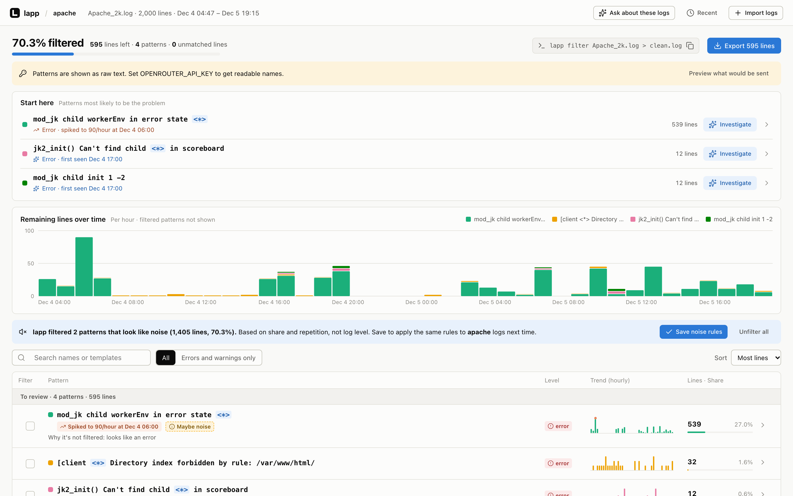

# lapp

**Find the problem in your logs, not the noise.**

Drop in a log file and lapp shows you where to look first: errors that suddenly spiked and patterns that never appeared before. Click any of them to see the lines behind it, or hand it to Claude Code or Codex to investigate. Every claim in the answer links to the pattern and lines behind it.



To get there, lapp groups thousands of repetitive lines into a few named patterns and filters out the noise (health checks, heartbeats, routine requests). On a 2,000-line Apache sample log, that's 6 patterns, 70% of lines filtered, and one spiking error at the top of the list.

Your logs stay on your machine except in two cases you opt into. If you set an OpenRouter key, lapp sends a few sample lines from each pattern to an LLM to name the pattern; without a key, patterns are shown as their raw text. If you click **Investigate**, your Claude Code or Codex reads the filtered patterns, and like any session of theirs, what it reads goes to that agent's provider.

## Quick start

```bash
lapp app.log                                    # a file
kubectl logs deploy/api | lapp --name api.log   # a pipe
```

lapp reads plain text, NDJSON, and Grafana Explore exports (Download as CSV or JSON). It finds the patterns and opens them in your browser. To pull logs from GCP Cloud Logging or VictoriaLogs, use **Import logs** in the page. A VictoriaLogs import splits logs by stream into one service each, named by the stream's `service.name`, `service`, `app` or `job` label, so each service keeps its own noise rules. VictoriaLogs credentials come from `VICTORIALOGS_BEARER_TOKEN`, or `VICTORIALOGS_USERNAME` and `VICTORIALOGS_PASSWORD`, in the environment or `.env` where lapp runs; the page never asks for them.

Tested against a local VictoriaLogs; not yet verified through a real Grafana proxy.

If VictoriaLogs is only reachable through Grafana, point `--url` at the Grafana data source proxy and use a Grafana service account token:

If a gateway such as Cloudflare Access sits in front, add its headers with `VICTORIALOGS_HEADERS` (`Name: value`, separated by `;`), preferably in `.env` so the values stay out of shell history:

```bash
VICTORIALOGS_BEARER_TOKEN=<grafana-service-account-token> \
VICTORIALOGS_HEADERS='CF-Access-Client-Id: <id>; CF-Access-Client-Secret: <secret>' \
  lapp workspace import victorialogs --topic prod --since 30m \
  --url https://grafana.example.com/api/datasources/proxy/uid/<datasource-uid> \
  --query 'service.name:postgres_logs'
```

1. **Start here.** A short list of the patterns most likely to be the problem: steady errors first, then spiking errors, other errors, warnings, other spikes, and patterns that are new since the last import of the same service.
2. **Investigate.** Click **Investigate** on any of them. Your local Claude Code or Codex reads the filtered patterns and explains the likely cause, citing the patterns and times it relied on.
3. **Hide noise.** Patterns that look like noise are tagged **Likely noise**, with the reason on hover. Click **Hide** or **Not noise** on the row, or hide any other pattern from its row. The share hidden and the lines left update as you go.
4. **Keep the decisions.** Every Hide, Not noise and Unhide is saved for the service right away, and lapp applies it the next time you open logs from the same service.
5. **Take the result with you.** Export an investigation summary (Markdown) for an issue, or export the filtered logs. From the command line:

```bash
lapp filter app.log > clean.log          # the log without lines hidden as noise
lapp summary app.log --json              # patterns, spikes and noise marks for scripts and coding agents
```

lapp never changes your original log files. Filtering only affects what you see and what you export.

The **Logs volume** chart shows lines over time when at least half of them have a time. If a CSV file has no time lapp can read, choose its **Time column** in the chart card; lapp remembers it for the service. From then on the CSV header row is not counted as a log line, and exported lines (including `lapp filter`) leave it out.

## Install

<!-- TODO: fill in once v0.1 ships (go install / Homebrew). Until then: -->

```bash
git clone https://github.com/STRRL/lapp && cd lapp
(cd frontend && pnpm install)
make build
export PATH="$PWD/output:$PATH"
```

Needs Go 1.26+, Node.js and pnpm. Optional: `OPENROUTER_API_KEY` for readable pattern names. Before anything is sent, lapp shows you exactly which lines will go to OpenRouter. Anything that looks like an email, IP address or token is replaced with `<email>`, `<ip>` or `<token>` by default.

## Commands

| Command | What it does |
|---|---|
| `lapp <file>` | Import a log file, find patterns, open the page (`--no-open` to skip the browser) |
| `<cmd> \| lapp --name <name>` | Same, from a pipe. lapp names the service after it (`api.log` → `api`); without `--name` the service is `stdin` |
| `lapp filter <file>` | Print the log without lines hidden as noise, using the service's saved rules |
| `lapp summary <file> [--json]` | Print patterns, counts, spikes, new patterns and noise marks |
| `lapp web` | Open the page without importing anything |
| `lapp workspace import victorialogs --topic <t> --url <url> [--query <LogsQL>] (--since <dur> \| --from <ts> --to <ts>) [--limit <n>]` | Pull logs from VictoriaLogs into one workspace per service, `<t>-<service>`; `--limit` applies per service. Then run `lapp workspace discover --topic <t>-<service>` |

The earlier `lapp workspace …` commands still work. The previous web UI is at `/classic`.

## Contributing

```bash
make dev      # rebuild and start the web UI on 127.0.0.1:8080
make test     # unit + integration tests
make check    # format, lint, type-check, build, unit tests
```

Integration tests use the [Loghub](https://github.com/logpai/loghub) datasets: `LOGHUB_PATH=/path/to/2k_dataset make integration-test`. Design notes are in [`docs/`](docs/) and [`CONTEXT.md`](CONTEXT.md).

## License

MIT
